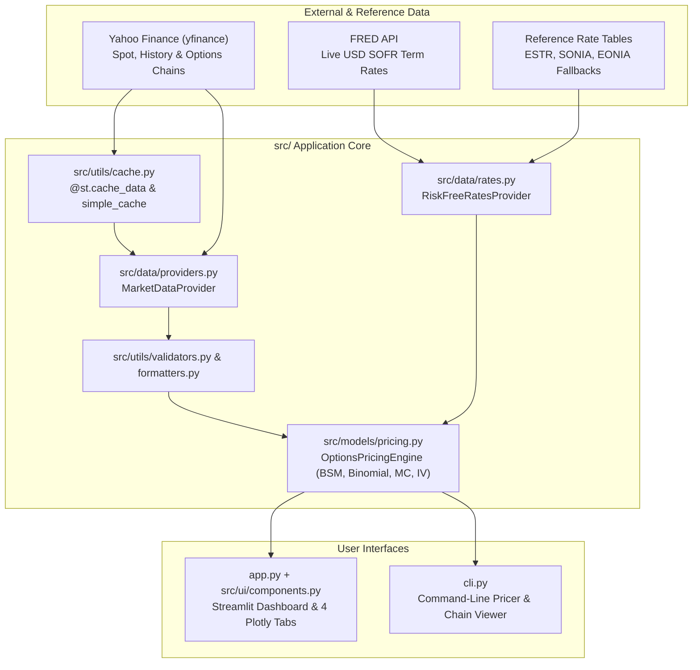

<h1 align="center">📈 CME Equity Options Pricer &amp; Analytics Platform</h1>

<p align="center">
  <strong>Modular quantitative equity options pricing workbench and CLI powered by Black-Scholes-Merton, Cox-Ross-Rubinstein Binomial Trees, and Monte Carlo simulation — complete with live Yahoo Finance options chains, FRED SOFR benchmark rates, Brent implied-volatility inversion, and 4 interactive Plotly analytics modules.</strong>
</p>

<p align="center">
  <a href="#-overview"><b>Overview</b></a> •
  <a href="#-analytical-and-pricing-models"><b>Pricing Models</b></a> •
  <a href="#-streamlit-ui-and-analytics-tabs"><b>UI &amp; Analytics</b></a> •
  <a href="#-architecture"><b>Architecture</b></a> •
  <a href="#-repository-structure"><b>Structure</b></a> •
  <a href="#-installation-and-usage"><b>Setup &amp; Usage</b></a> •
  <a href="#-docker-deployment"><b>Docker</b></a> •
  <a href="#-testing"><b>Tests</b></a>
</p>

<p align="center">
  
  
  
  
  <a href="LICENSE"></a>
</p>

<p align="center">
  
  
  
  
</p>

---

## 📊 Overview

**CME Equity Options Pricer** ([`khalid-naami/CME-options-data`](https://github.com/khalid-naami/CME-options-data)) is a dual-interface quantitative options analysis platform built around a decoupled `src/` architecture (`models`, `data`, `ui`, `utils`, and `config`). It ingests live equity quotes and multi-expiry options chains from **Yahoo Finance**, enriches risk-free discounting with live US **SOFR** term rates from the **FRED API** (alongside built-in EUR `ESTR`/`EONIA` and GBP `SONIA` reference curves), and benchmarks market option prices against three independent valuation engines through both a **Streamlit** dashboard (`app.py`) and a scriptable **CLI** (`cli.py`).

### Key Capabilities

| Capability | Implementation Details | Source Module |
|---|---|---|
| **Multi-Model Valuation** | Black-Scholes-Merton (continuous dividend yield $q$), CRR Binomial Tree (100 default steps), and Geometric Brownian Motion Monte Carlo (10,000 default paths). | [`src/models/pricing.py`](src/models/pricing.py) |
| **Analytical Greeks &amp; IV Solver** | Exact **Delta**, **Gamma**, daily **Theta**, **Vega** (per 1% IV), and **Rho** (per 1% rate); root-finding Implied Volatility via Brent's method (`brentq`). | [`src/models/pricing.py`](src/models/pricing.py) |
| **Live Market &amp; Chain Ingestion** | Fetches stock fundamentals, 6-month historical volatility (`20d` rolling), and options chains (up to 3 expiries in Streamlit cache / 6 in provider) with ITM/ATM/OTM classification. | [`src/data/providers.py`](src/data/providers.py), [`src/utils/cache.py`](src/utils/cache.py) |
| **Multi-Currency Rate Curve Engine** | Live **FRED API** fetches for US `SOFR` (`SOFR`, `SOFR1M`, `SOFR3M`, `SOFR6M`, `SOFR12M`) when `FRED_API_KEY` is set; fallback/reference curves for `ESTR`, `SONIA`, and `EONIA` with expiry-matched tenor recommendations. | [`src/data/rates.py`](src/data/rates.py) |
| **Input Validation &amp; Caching** | Validates tickers, strikes, rates ($[-10\%, 50\%]$), volatility ($[1\%, 500\%]$), and expiry formats; `@st.cache_data` (300s–600s TTL) + `simple_cache`. | [`src/utils/validators.py`](src/utils/validators.py), [`src/utils/formatters.py`](src/utils/formatters.py) |
| **CLI &amp; Containerized Deployment** | Positional CLI (`python cli.py AAPL ...`), multi-stage `python:3.13-slim` Dockerfile, `docker-compose` dev/prod stacks, and PowerShell/Bash management scripts. | [`cli.py`](cli.py), [`Dockerfile`](Dockerfile), [`DOCKER.md`](DOCKER.md) |

---

## 🧮 Analytical and Pricing Models

All core computations reside in `OptionsPricingEngine` inside [`src/models/pricing.py`](src/models/pricing.py):

### 1. Black-Scholes-Merton (Continuous Dividend Yield $q$)

$$d_1 = \frac{\ln(S / K) + (r - q + \tfrac{1}{2}\sigma^2)T}{\sigma\sqrt{T}}, \qquad d_2 = d_1 - \sigma\sqrt{T}$$

$$C = S e^{-qT} N(d_1) - K e^{-rT} N(d_2), \qquad P = K e^{-rT} N(-d_2) - S e^{-qT} N(-d_1)$$

- **Greeks Scaling**: $\Theta$ is annualized and divided by `365` (daily decay); $\nu$ (Vega) and $\rho$ (Rho) are divided by `100` (sensitivity per `1%` shift in $\sigma$ or $r$).

### 2. Cox-Ross-Rubinstein Binomial Tree

For $N$ steps (`steps = 100` default, $\Delta t = T / N$):

$$u = e^{\sigma\sqrt{\Delta t}}, \qquad d = \frac{1}{u}, \qquad p = \frac{e^{(r - q)\Delta t} - d}{u - d}$$

Terminal payoffs are discounted via backward induction $V_{j,i} = e^{-r\Delta t}\big(p V_{j,i+1} + (1 - p) V_{j+1,i+1}\big)$.

### 3. Monte Carlo Simulation &amp; Implied Volatility

Terminal spot paths are simulated under risk-neutral GBM (`seed = 42`, `simulations = 10,000` default) and discounted as $e^{-rT}\,\mathbb{E}[\max(\pm(S_T - K), 0)]$:

$$S_T = S_0 \exp\!\left((r - q - \tfrac{1}{2}\sigma^2)T + \sigma\sqrt{T}\,Z\right), \quad Z \sim \mathcal{N}(0, 1)$$

Implied volatility solves $V_{\text{BS}}(S, K, T, r, \sigma, q) - V_{\text{market}} = 0$ via `scipy.optimize.brentq` over $\sigma \in [0.001, 5.0]$.

---

## 🖥️ Streamlit UI and Analytics Tabs

Launching `streamlit run app.py` loads:

1. **Sidebar Controls**: Quick selector for `SPY`, `QQQ`, `IWM`, `AAPL`, `MSFT`, `GOOGL`, `AMZN`, `TSLA`, `NVDA`, `META` or custom ticker, live risk-free rate refresh (`Refresh Rates`), and URL override support (`?volatility=25.0`).
2. **Stock Overview &amp; Chain Filters**: 4-column stock metrics, filters for Option Type (`All`, `call`, `put`), Expiration Date, Moneyness (`ITM`, `ATM` within $\pm 2\%$, `OTM`), and single-strike isolation.
3. **Pricing Breakdown &amp; Market Comparison Table**: Side-by-side Black-Scholes, Binomial Tree, and Monte Carlo estimates, intrinsic/time value split, and market deviation columns (`theoretical_price`, `price_diff`, `price_diff_pct`).
4. **4 Interactive Plotly Tabs (`render_option_analysis_plots`)**:
   - **📈 Price vs IV**: Call/put scatter plots colored by Moneyness, Days to Expiry, or Option Type, optional theoretical price markers, and `UnivariateSpline` IV smile curve.
   - **🎯 Greeks Comparison**: Multi-Greek subplots (`delta`, `gamma`, `theta`, `vega`, `rho`) overlaying market vs. theoretical values, optional standardization, and `LinearRegression` trend lines.
   - **💰 Model Comparison**: Benchmarks up to 50 sampled options across Black-Scholes, Binomial (`100` steps), and Monte Carlo (`5,000` paths) with $\pm 10\%$ confidence bands, residual distributions, and **RMSE, MAE, MAPE, and Correlation** cards.
   - **📊 Sensitivity Analysis**: Spot sensitivity ($0.8S \to 1.2S$) and volatility sensitivity ($10\% \to 100\%$) curves for the nearest-to-ATM option.

---

## 🏗️ Architecture



---

## 📂 Repository Structure

```text
CME-options-data/
├── .devcontainer/
│   └── devcontainer.json                 # VS Code / Codespaces Python 3.11 container config
├── .dockerignore
├── .gitattributes
├── .gitignore
├── LICENSE                               # MIT License
├── README.md
├── DOCKER.md                             # Detailed Docker & Nginx/Redis production guide
├── Dockerfile                            # Multi-stage python:3.13-slim image (port 8501)
├── docker-compose.yml                    # Local Streamlit service definition
├── docker-compose.prod.yml               # Production stack (Streamlit + Nginx + Redis)
├── docker-run.ps1                        # Windows PowerShell Docker lifecycle script
├── docker-run.sh                         # Linux/macOS Bash Docker lifecycle script
├── requirements.txt                      # Python package dependencies
├── app.py                                # Main Streamlit application entrypoint
├── cli.py                                # Command-line options pricer & chain inspector
├── config/
│   ├── __init__.py
│   └── settings.py                       # APIConfig, PricingConfig, UIConfig dataclasses
├── src/
│   ├── __init__.py
│   ├── core/
│   │   └── __init__.py                   # Core package namespace
│   ├── data/
│   │   ├── __init__.py
│   │   ├── providers.py                  # StockDataProvider, OptionsDataProvider, MarketDataProvider
│   │   └── rates.py                      # RiskFreeRatesProvider (FRED SOFR + ESTR/SONIA/EONIA)
│   ├── models/
│   │   ├── __init__.py
│   │   └── pricing.py                    # OptionsPricingEngine (BSM, Binomial, Monte Carlo, Greeks, IV)
│   ├── ui/
│   │   ├── __init__.py
│   │   └── components.py                 # StreamlitComponents (sidebar, tables, 4 Plotly tabs)
│   └── utils/
│       ├── __init__.py
│       ├── cache.py                      # Streamlit & in-memory TTL caching helpers
│       ├── formatters.py                 # DataFormatter & CLIFormatter
│       └── validators.py                 # DataValidator input checks
├── tests/
│   ├── __init__.py
│   ├── test_pricing.py                   # Unit tests (BSM, put-call parity, Greeks, validators)
│   ├── test_enhanced_plots.py            # Spline, regression & metric verification script
│   ├── test_plots.py                     # Plot imports & tab workflow verification
│   ├── test_price_fix.py                 # Live yfinance price fallback check
│   ├── test_rate_update.py               # RiskFreeRatesProvider smoke test
│   ├── test_strike_filter.py             # Strike-filter workflow simulation
│   ├── validate_fix.py                   # Session-state rate-update simulation
│   ├── test_final.py                     # Placeholder test module
│   └── test_options_fix.py               # Placeholder test module
└── backups/                              # Legacy pre-refactor snapshots
```

---

## 🚀 Installation and Usage

### Prerequisites

- **Python** `3.8+` (`3.11` in DevContainer, `3.13` in `Dockerfile`)
- **Docker Desktop** *(optional, for containerized deployment)*

### 1. Clone and Install

```bash
git clone https://github.com/khalid-naami/CME-options-data.git
cd CME-options-data

python -m venv .venv
```

```powershell
# Windows (PowerShell)
.venv\Scripts\Activate.ps1
```

```bash
# macOS / Linux
source .venv/bin/activate
```

```bash
pip install -r requirements.txt
```

### 2. Optional Environment Configuration (`.env`)

Create a `.env` file in the project root (automatically loaded via `python-dotenv` in `config/settings.py`) to enable live US SOFR rates from FRED:

```env
FRED_API_KEY=your_fred_api_key_here
ALPHA_VANTAGE_API_KEY=your_optional_alpha_vantage_key
DEBUG=False
```

### 3. Run the Streamlit Web App

```bash
streamlit run app.py
```

Open **`http://localhost:8501`** in your browser (optional query parameter: `?volatility=25.0`).

### 4. Run the Command-Line Interface (`cli.py`)

`symbol` is a positional argument:

```bash
# Inspect options chain (first 20 contracts)
python cli.py AAPL --show-chain

# Price a specific call option with full Greeks output
python cli.py AAPL --strike 230 --expiry 2026-12-18 --option-type call

# Custom risk-free rate and volatility, returning theoretical price only
python cli.py SPY --strike 580 --expiry 2026-12-18 --option-type put --rate 0.045 --volatility 0.20 --price-only
```

### 5. Use as a Python Library

```python
from src.models.pricing import OptionsPricingEngine
from src.data.providers import MarketDataProvider
from src.data.rates import get_risk_free_rates

engine = OptionsPricingEngine(risk_free_rate=0.05)
market = MarketDataProvider().get_complete_market_data("SPY")
spot = market["current_price"]

greeks = engine.calculate_greeks(S=spot, K=round(spot), T=0.25, r=0.05, sigma=0.20, option_type="call")
breakdown = engine.calculate_pricing_breakdown(S=spot, K=round(spot), T=0.25, r=0.05, sigma=0.20, option_type="call")
```

---

## 🐳 Docker Deployment

Full details are available in [`DOCKER.md`](DOCKER.md). Quick-start commands:

```powershell
# Windows PowerShell helper
.\docker-run.ps1 run        # Builds image & starts container on port 8501
.\docker-run.ps1 compose    # Starts via docker-compose.yml
```

```bash
# Linux / macOS helper
chmod +x docker-run.sh
./docker-run.sh run

# Or manual Docker build & run
docker build -t cme-equity-options-pricer:latest .
docker run -d --name cme-equity-options-pricer -p 8501:8501 --env-file .env cme-equity-options-pricer:latest

# Production Compose stack (Streamlit + Nginx + Redis)
docker-compose -f docker-compose.prod.yml up -d
```

---

## 🧪 Testing

Run the core unit test suite (`unittest`) and auxiliary verification scripts locally:

```bash
# Core pricing, put-call parity, Greeks, validator & formatter unit tests
python -m unittest tests/test_pricing.py -v

# Additional verification scripts
python tests/test_enhanced_plots.py
python tests/test_rate_update.py
python tests/validate_fix.py
```

> *Note: `tests/test_price_fix.py` performs live network calls to Yahoo Finance (`yfinance`).*

---

## 🌐 External Data Providers, Disclaimers and License

- **Market Data**: Yahoo Finance via `yfinance` (delayed/public equity quotes, historical bars, and options chains).
- **Interest Rates**: Federal Reserve Economic Data (**FRED API**) for live USD `SOFR` term rates when `FRED_API_KEY` is provided; built-in reference rates for `ESTR`, `SONIA`, `EONIA`, and offline `SOFR` fallback.
- **Disclaimer**: This software is intended strictly for educational, quantitative research, and analytical use. Theoretical model values depend on volatility, rate, and dividend assumptions and do not constitute financial advice.
- **License**: Released under the **MIT License** — see [LICENSE](LICENSE).
